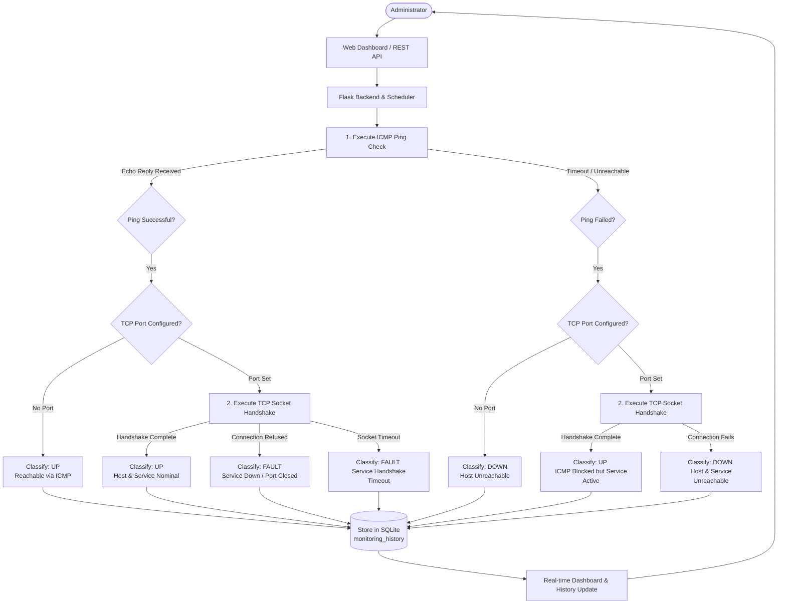

# Automated Fault Detection System (AFDS)

An enterprise-grade, laboratory-oriented network monitoring and automated fault detection web application built with Python Flask, ICMP/Ping subprocess integration, raw TCP socket programming, SQLite persistence, and a high-contrast monochrome dashboard.

Designed specifically as a **Computer Networks Laboratory Project**, this application enables network administrators and laboratory instructors to register endpoints (IPv4/IPv6), verify end-to-end ICMP reachability, inspect specific TCP service socket availability, track historical fault occurrences, and configure monitoring thresholds through an academic, professional web dashboard.

---

## 1. Abstract

Modern enterprise and campus networks require continuous monitoring to ensure high availability of critical services. Traditional network troubleshooting often relies on manual command-line utilities such as `ping` and `telnet`, which are inefficient for multi-host infrastructures. The **Automated Fault Detection System (AFDS)** solves this problem by centralizing real-time connectivity testing and transport-layer verification into an automated, periodic web platform. By combining Internet Control Message Protocol (ICMP) echo requests with raw TCP three-way handshake socket probes, AFDS categorizes the health of each registered device into deterministic operational states (`UP`, `DOWN`, `FAULT`, or `UNKNOWN`), measuring precise latencies and archiving historical diagnostics in an ACID-compliant SQLite database.

---

## 2. Problem Statement

Network administrators frequently face challenges when diagnosing system outages:
- **Ambiguous Failure Modes**: An administrator may receive reports that a web service is down without knowing whether the host physical machine is unreachable (Layer 3 issue) or whether the host is reachable but the application service has crashed or closed its listening port (Layer 4/7 issue).
- **Manual Overhead**: Running ad-hoc terminal ping and port-scanning tools across multiple subnets is time-consuming and fails to maintain historical logs.
- **Resource Heavy Monitoring Tools**: Commercial monitoring suites (e.g., Zabbix, Nagios, SolarWinds) often require heavy daemon agents, complex third-party databases, and excessive server overhead unsuited for academic demonstrations or lightweight network labs.

---

## 3. Proposed Solution

The **Automated Fault Detection System** provides a lightweight, agentless architecture:
1. **Network-Layer Reachability (ICMP)**: Native OS-level echo probes determine whether the host IP route is operational and calculate round-trip time (RTT).
2. **Transport-Layer Verification (TCP Sockets)**: Standard Python BSD socket connections verify whether configured application ports (HTTP `80`, HTTPS `443`, SSH `22`, Flask `5000`, etc.) actively complete the TCP 3-way handshake.
3. **Deterministic Fault Triangulation**: The system distinguishes between general connectivity loss (`DOWN`) and service-specific failure (`FAULT`), recording granular error descriptions (e.g., connection refused, timeout, network unreachable).
4. **Autonomous Background Worker**: A dedicated Python background thread executes scheduled monitoring cycles at configurable intervals without blocking the Flask web server.
5. **Zero-Configuration Persistence**: Automatic runtime initialization of SQLite database schemas with strict foreign-key cascade policies.

---

## 4. Key Objectives

- Develop a modular Flask application with server-rendered HTML5 templates and responsive JavaScript updates.
- Implement secure, shell-injection-safe ICMP ping execution on Windows, Linux, and macOS.
- Perform real TCP socket connection tests measuring true connection latency in milliseconds.
- Classify device states strictly according to network observations without synthetic data.
- Provide full CRUD capabilities for network endpoints with duplicate collision prevention.
- Deliver an academic, high-contrast monochrome user interface free of decorative bloat.
- Provide comprehensive automated test coverage with mocked network calls using both `pytest` and `unittest`.

---

## 5. Technology Stack

- **Backend**: Python 3.10+
- **Web Framework**: Flask 3.0+
- **Network Layer Protocol**: ICMP Echo (via OS ping subprocess)
- **Transport Layer Protocol**: TCP Socket Programming (`socket.SOCK_STREAM`)
- **Database**: SQLite 3 (using standard library `sqlite3` with foreign-key enforcement)
- **Frontend**: Semantic HTML5, Vanilla CSS3 (custom monochrome design system), Modern JavaScript (Fetch API), Chart.js (local offline bundle)
- **Testing**: `pytest` and Python `unittest` framework with `unittest.mock`

> **Note**: No third-party enterprise databases, React, Node.js, Redis, or Docker containers are required. The application runs natively with minimal dependencies.

---

## 6. System Architecture & Workflow

### Monitoring Workflow Flowchart



---

## 7. Status Classification System

Every target device monitored by AFDS is classified into one of four distinct operational states:

| Status Badge | State Name | Technical Definition | Condition |
| :---: | :---: | :--- | :--- |
| `● UP` | **Operational** | The host responds to ICMP ping AND its configured TCP service is accepting connections (or ICMP succeeds when no port is configured). Also applies if ICMP is blocked by firewall policy but the TCP service socket completes handshake. | `Ping: OK` + `TCP: Open`<br>or `Ping: OK` + `Port: None`<br>or `Ping: Blocked` + `TCP: Open` |
| `▲ FAULT` | **Service Fault** | The device responds to network reachability (ICMP ping), but the configured TCP port actively refuses the connection, times out, or fails. | `Ping: OK` + `TCP: Refused / Timeout` |
| `✕ DOWN` | **Offline / Unreachable** | The host does not respond to ICMP ping AND its configured TCP service fails to connect or times out. | `Ping: Fail` + `TCP: Fail / None` |
| `○ UNCHECKED` | **Pending / Unknown** | Device newly registered; awaiting its first monitoring cycle. | Prior to execution |

---

## 8. Project Directory Structure

```text
NetFault-Network-Monitor/
|
|-- app.py                  # Flask application entry point, routes, and JSON API
|-- config.py               # System configuration, paths, defaults, and validation ranges
|-- database.py             # SQLite initialization, parameterized CRUD, and history queries
|-- monitoring.py           # Core network logic: IP validation, ICMP ping, and TCP socket probes
|-- scheduler.py            # Thread-safe background monitoring worker and bounded pool
|-- services.py             # CSV export generation, system diagnostics, and reporting
|-- requirements.txt        # Python dependency manifest
|-- README.md               # Complete project documentation
|-- .gitignore              # Git ignore rules for databases, logs, and environments
|
|-- templates/              # Server-rendered Jinja2 HTML templates
|   |-- base.html           # Master layout with sidebar navigation and top bar
|   |-- dashboard.html      # Central monitoring dashboard with summary metrics & chart
|   |-- devices.html        # Registered device inventory with search, filter, and pagination
|   |-- add_device.html     # Registration form for new network targets
|   |-- edit_device.html    # Configuration editing form
|   |-- device_details.html # Comprehensive device diagnostic status & recent history
|   |-- history.html        # Filterable, paginated audit log with CSV export
|   |-- faults.html         # Incident diagnostics & fault reports with CSV export
|   |-- settings.html       # Dynamic runtime parameter configuration
|   |-- system.html         # Runtime environment & SQLite persistence diagnostics
|   |-- 404.html            # Not Found error page
|   |-- 500.html            # Internal Server Error page
|
|-- static/                 # Static frontend assets
|   |-- css/
|   |   |-- style.css       # Laboratory-grade monochrome stylesheet
|   |
|   |-- js/
|       |-- chart.umd.min.js# Offline bundled Chart.js library
|       |-- dashboard.js    # Asynchronous polling, live check triggers, and UI controls
|       |-- devices.js      # Device inventory management interactions
|       |-- history.js      # Audit log keyboard navigation helpers
|
|-- instance/               # Runtime database directory (auto-created)
|   |-- network_monitor.db  # SQLite database file
|
|-- logs/                   # System runtime log files
|   |-- app.log             # Diagnostic execution log
|
|-- tests/                  # Automated unit and integration test suite
    |-- test_database.py    # Database schema, CRUD, cascade, and settings tests
    |-- test_monitoring.py  # Network validation, mocked ping, sockets, & status tests
    |-- test_routes.py      # Flask views, form validation, error pages, & API tests
    |-- test_devices.py     # Device search, filtering, pagination, & concurrency tests
```

---

## 9. Database Schema

The SQLite schema is initialized automatically in `instance/network_monitor.db` on server startup:

### Table: `devices`
- `id` (INTEGER PRIMARY KEY AUTOINCREMENT)
- `device_name` (TEXT NOT NULL)
- `ip_address` (TEXT NOT NULL)
- `port` (INTEGER, NULLABLE)
- `description` (TEXT, NULLABLE)
- `monitoring_enabled` (INTEGER DEFAULT 1)
- `created_at` (TIMESTAMP DEFAULT CURRENT_TIMESTAMP)
- `updated_at` (TIMESTAMP DEFAULT CURRENT_TIMESTAMP)

### Table: `monitoring_history`
- `id` (INTEGER PRIMARY KEY AUTOINCREMENT)
- `device_id` (INTEGER NOT NULL, FOREIGN KEY -> `devices.id` ON DELETE CASCADE)
- `checked_at` (TIMESTAMP DEFAULT CURRENT_TIMESTAMP)
- `reachability_status` (TEXT NOT NULL: `REACHABLE`, `UNREACHABLE`, `ICMP_FILTERED`)
- `service_status` (TEXT NOT NULL: `OPEN`, `REFUSED`, `TIMEOUT`, `CLOSED`, `NOT_CONFIGURED`, `NOT_CHECKED`)
- `overall_status` (TEXT NOT NULL: `UP`, `DOWN`, `FAULT`)
- `response_time_ms` (REAL, NULLABLE)
- `fault_category` (TEXT, NULLABLE: `NONE`, `SERVICE_REFUSED`, `SERVICE_TIMEOUT`, `HOST_UNREACHABLE`, `NETWORK_TIMEOUT`, `FIREWALL_FILTERED`, `SOCKET_ERROR`)
- `fault_details` (TEXT, NULLABLE)

### Table: `settings`
- `key` (TEXT PRIMARY KEY)
- `value` (TEXT NOT NULL)
- `updated_at` (TIMESTAMP DEFAULT CURRENT_TIMESTAMP)

---

## 10. Installation & Setup Instructions (Windows & VS Code)

### Prerequisites
- Windows 10 or Windows 11
- Python 3.10+ installed and added to `PATH`
- Visual Studio Code

### Step-by-Step Setup

1. **Open Project in Visual Studio Code**
   Open Visual Studio Code, click **File > Open Folder...**, and select the project directory:
   ```text
   NetFault-Network-Monitor
   ```

2. **Open Terminal in VS Code**
   Press ``Ctrl + ` `` or click **Terminal > New Terminal** (PowerShell or Command Prompt).

3. **Create and Activate Virtual Environment** (Optional but recommended):
   ```powershell
   python -m venv .venv
   .\.venv\Scripts\Activate.ps1
   ```
   *(If script execution is restricted in PowerShell, run `Set-ExecutionPolicy -Scope Process -ExecutionPolicy Bypass` first).*

4. **Install Dependencies**:
   ```powershell
   python -m pip install -r requirements.txt
   ```

5. **Run the Automated Test Suite**:
   ```powershell
   python -m pytest
   ```
   *All 36 unit tests across database, monitoring, routes, and devices will run and pass.*

6. **Launch the Application**:
   ```powershell
   python app.py
   ```

7. **Access the Application**:
   Open Google Chrome, Microsoft Edge, or Mozilla Firefox and navigate to:
   ```text
   http://127.0.0.1:5000
   ```

---

## 11. User Guide & Demonstration Scenarios

### How to Register a Device
1. Navigate to **Devices** > **+ Add Device** (or click **Add Device** on the Dashboard).
2. Enter the device name and valid IPv4 or IPv6 address.
3. Optionally enter a TCP port (e.g., `80`, `443`, `22`, `5000`).
4. Keep **Enable Automated Periodic Monitoring** checked.
5. Click **Save & Run Initial Probe**.

### How to Check a Device
- **Single Check**: Click the **Check Now** button on any device row on the Dashboard or Devices page.
- **Batch Check**: Click **Check All** in the Dashboard action bar to probe all registered devices concurrently.

### How to Interpret Fault Reports
1. Navigate to **Fault Reports** in the sidebar.
2. Filter incidents by device, fault category, or operational state.
3. Review consecutive failure counts and detailed diagnostic messages.
4. Click **Export Faults CSV** to download a spreadsheet report for lab documentation.

### How to View History and Export Audit Logs
1. Navigate to **Monitoring History** in the sidebar.
2. Filter audits by device, state (`UP`, `DOWN`, `FAULT`), or date range.
3. Click **Export CSV** to download an immutable audit record.

### How to Configure Automatic Monitoring
1. Navigate to **Settings** in the sidebar.
2. Adjust the periodic interval (e.g., 15–60 seconds), ping timeout, and concurrency limit.
3. Toggle background monitoring on or off.
4. Click **Save & Persist Settings**. Changes take effect immediately on subsequent cycles without restarting the server.

---

## 12. Automated Test Execution

AFDS includes comprehensive automated test coverage with mocked network operations so that tests execute rapidly without requiring an active external internet connection:

```powershell
# Run with pytest:
python -m pytest -v

# Or run with standard unittest runner:
python -m unittest discover tests
```

---

## 13. Known Limitations

- **Raw ICMP Privileges**: Unprivileged user spaces on modern OS environments cannot open raw ICMP sockets without administrative elevation; hence, AFDS uses native OS ping subprocess execution.
- **Stealth Firewalls**: Firewalls that silently drop packets without returning TCP RST or ICMP destination unreachable packets can only be detected via configured timeout thresholds.
- **Subnet Sweeping**: In adherence to safety guidelines, the tool does not perform unprompted subnet range scans. Only explicitly registered targets are monitored.

---

## 14. Academic Project Report Summary

| Feature | Implementation Details |
| :--- | :--- |
| **Project Title** | Automated Fault Detection System (AFDS) |
| **Discipline** | Computer Networks / Network Engineering |
| **Framework** | Python 3 + Flask 3.0+ |
| **Networking** | OS Ping Subprocess (Layer 3) + Python BSD Sockets (Layer 4) |
| **Database** | SQLite 3 (`network_monitor.db`) with Foreign Keys & CASCADE |
| **UI Design** | Monochrome Laboratory Design System, Inter Typography |
| **Visualization** | Chart.js 4.4.1 (100% offline local bundle) |
| **Concurrency** | Bounded `ThreadPoolExecutor` Worker Pool |
| **Security** | CSRF Protection, Strict IP/Port Validation, Safe Subprocess Args |
